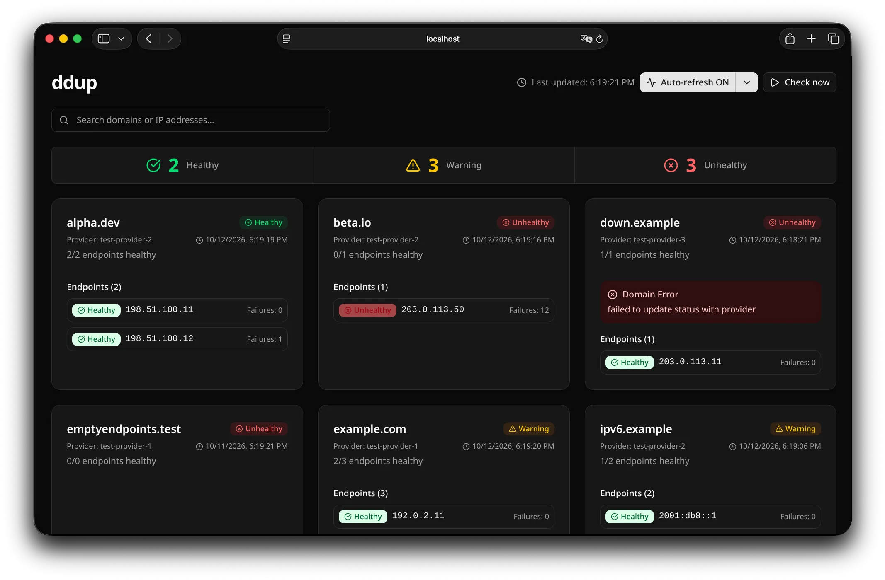

<div align="center">
  
</div>

# ddup - Dynamic DNS Health Checker

**[Read the docs](https://ddup.italypaleale.me)**

> **Fork note:** this is a fork of [ItalyPaleAle/ddup](https://github.com/ItalyPaleAle/ddup) with one addition on top of upstream: a `server.basePath` option to serve the dashboard and API under a sub-path (see [`config.sample.yaml`](/config.sample.yaml)). CNAME support now comes from upstream and uses the per-endpoint `cname` field; if you are upgrading from an older build of this fork, see [Migrating from `recordType`](#migrating-from-recordtype) below.

## Migrating from `recordType`

Older builds of this fork configured CNAME domains with a domain-level `recordType: "CNAME"` field, with the target hostname stored in each endpoint's `ip` field. Upstream replaced this with a per-endpoint `cname` field, and ddup rejects unknown config keys, so configs must be migrated before starting the new build.

Change this:

```yaml
domains:
  - recordName: "tunnel.example.com"
    provider: "my-cloudflare"
    recordType: "CNAME"
    endpoints:
      - name: "tunnel"
        url: "https://tunnel-health.example.com/health"
        ip: "0a1b2c3d.cfargotunnel.com"
```

To this:

```yaml
domains:
  - recordName: "tunnel.example.com"
    provider: "my-cloudflare"
    endpoints:
      - name: "tunnel"
        url: "https://tunnel-health.example.com/health"
        cname: "0a1b2c3d.cfargotunnel.com"
        providerOptions:
          cloudflare:
            # Optional: proxy the record through Cloudflare
            proxied: true
```

Rules:

- Remove `recordType` from the domain; it is no longer a valid key
- For each endpoint of a CNAME domain, move the hostname from `ip` to `cname`
- A domain now mixes endpoints: `ip` endpoints publish A/AAAA records, `cname` endpoints publish a CNAME record
- An endpoint with `cname` must be the only one at its priority level, since a CNAME record can't coexist with other records
- CNAME is supported by the Cloudflare provider only; other providers reject it at startup
- One-liner migration with [yq](https://github.com/mikefarah/yq) (make a backup first):

```sh
yq -i '(.domains[] | select(.recordType == "CNAME")) |= (del(.recordType) | .endpoints |= map(.cname = .ip | del(.ip)))' config.yaml
```

In the old fork every endpoint of a `recordType: "CNAME"` domain held a hostname in `ip`, so the expression above covers the whole migration. If an endpoint ends up with what is actually an IP address in `cname`, ddup rejects it at startup — move it back to `ip` by hand, and it will be published as an A/AAAA record.

ddup keeps your DNS records pointed at the servers that are up. It checks each server over HTTP on a schedule, and updates the A and AAAA records of a domain so they list only the healthy ones.

Use it to set up [round-robin DNS](https://en.wikipedia.org/wiki/Round-robin_DNS) for load balancing and failover, for internal or public apps, without running a load balancer.

ddup isn't a DNS server. It changes the records in the DNS service that already hosts your zone, using that service's API.



## Features

- Health checks multiple apps over HTTP or HTTPS
- Round-robin across all healthy endpoints, or priorities that keep backup servers out of DNS until the main ones fail
- A records for IPv4 addresses, AAAA records for IPv6, and CNAME records with supported providers
- A dashboard and an API with the health of every domain and endpoint
- Notifications by webhook or email when DNS changes, an update fails, or a domain has no healthy endpoint

## Supported DNS providers

- [AWS Route 53](https://ddup.italypaleale.me/providers/aws-route53)
- [Azure DNS](https://ddup.italypaleale.me/providers/azure-dns)
- [Cloudflare](https://ddup.italypaleale.me/providers/cloudflare)
- [Google Cloud DNS](https://ddup.italypaleale.me/providers/google-cloud-dns)
- [OVHcloud](https://ddup.italypaleale.me/providers/ovh)

## Docs

The documentation is at [`https://ddup.italypaleale.me`](https://ddup.italypaleale.me).

- [Quickstart](https://ddup.italypaleale.me/docs/quickstart)
- [Installation](https://ddup.italypaleale.me/docs/installation)
- [Configuration](https://ddup.italypaleale.me/docs/configuration)
- [Health checks](https://ddup.italypaleale.me/docs/health-checks)
- [Failover with priorities](https://ddup.italypaleale.me/docs/failover-priorities)
- [Dashboard and API](https://ddup.italypaleale.me/docs/dashboard)
- [Notifications](https://ddup.italypaleale.me/docs/notifications)
- [Logs and metrics](https://ddup.italypaleale.me/docs/observability)
- [DNS providers](https://ddup.italypaleale.me/providers)

## Development

To build, run and test ddup from source, see [DEVELOPMENT.md](./DEVELOPMENT.md).

## License

This project is licensed under the MIT License.

